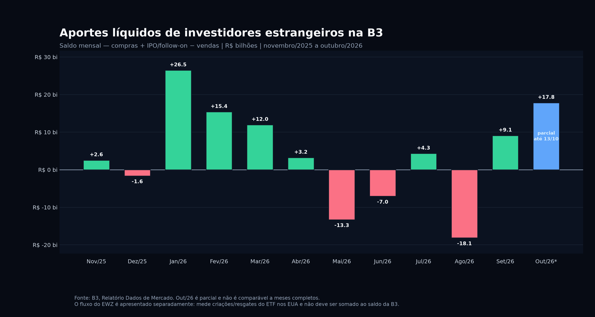

# Aportes líquidos de investidores estrangeiros na B3 — últimos 12 meses

## Leitura da série

A série oficial da B3 registra, entre novembro de 2025 e setembro de 2026, **R$ 32,9622 bilhões** de entrada líquida estrangeira. Em 11 meses completos, houve sete meses positivos e quatro negativos; a média mensal foi de **R$ 2,9966 bilhões**.[1]

O maior ingresso completo foi em janeiro de 2026, com **R$ 26,4713 bilhões**. A maior saída ocorreu em agosto de 2026, com **R$ 18,1168 bilhões**. O mês de outubro já registrava **R$ 17,8271 bilhões** até 13/10, mas é parcial e não deve ser comparado diretamente com meses fechados.[1]

| Mês | Saldo líquido estrangeiro | Situação |
|---|---:|---|
| Nov/25 | R$ 2,5501 bi | Fechado |
| Dez/25 | -R$ 1,6201 bi | Fechado |
| Jan/26 | R$ 26,4713 bi | Fechado |
| Fev/26 | R$ 15,3957 bi | Fechado |
| Mar/26 | R$ 11,9643 bi | Fechado |
| Abr/26 | R$ 3,2216 bi | Fechado |
| Mai/26 | -R$ 13,2749 bi | Fechado |
| Jun/26 | -R$ 7,0473 bi | Fechado |
| Jul/26 | R$ 4,3115 bi | Fechado |
| Ago/26 | -R$ 18,1168 bi | Fechado |
| Set/26 | R$ 9,1068 bi | Fechado |
| Out/26 | R$ 17,8271 bi | **Parcial — até 13/10** |

A soma dos 12 pontos do gráfico é **R$ 50,7893 bilhões**, mas não é uma métrica anualizada válida porque outubro é parcial. O acumulado de janeiro a setembro de 2026 é **R$ 32,0322 bilhões**; outubro deve ser tratado como leitura de tendência, não como mês fechado.[1]

## Relação com o EWZ

O gráfico mede exclusivamente o saldo de investidores estrangeiros na B3: **compras + IPO/follow-on − vendas**, em reais. O EWZ não entra nessa série. O ETF recebeu **US$ 2,30387 bilhões** em criações líquidas na semana encerrada em 09/10/2026, o que confirma demanda offshore por exposição ao Brasil, mas não pode ser somado diretamente à B3 sem risco de dupla contagem.[3]

## Base, data e limitações

**Base:** saldo líquido mensal em R$ milhões, convertido no gráfico para R$ bilhões. **Janela:** novembro de 2025 a outubro de 2026. **Data de corte:** 15/10/2026; o arquivo oficial consultado traz outubro até 13/10. A B3 informa a movimentação estrangeira em D+2 e a série inclui mercado à vista, fracionário, ETF de renda fixa, leilões, termo, opções e blocos, conforme sua metodologia.[1] [2]

**Fontes e confiança:** alta para a série B3, pois utiliza a base oficial da bolsa; alta para o fluxo semanal de EWZ informado pela ETF.com. O valor parcial de outubro permanece sujeito à atualização da série oficial.

*Esta é pesquisa e análise somente, não recomendação financeira personalizada.*

## Referências

[1]: https://sistemaswebb3-listados.b3.com.br/marketDataProxy/MarketDataCall/GetDownloadMarketData/RELATORIO_DADOS_DE_MERCADO.csv "B3 — Relatório Dados de Mercado"
[2]: https://www.b3.com.br/pt_br/market-data-e-indices/servicos-de-dados/market-data/consultas/mercado-a-vista/dados-de-mercado/ "B3 — Metodologia e periodicidade dos dados de mercado"
[3]: https://www.etf.com/sections/weekly-etf-flows/etf-inflows-top-41b-investors-pile-brazil-long-bonds "ETF.com — Fluxo semanal do EWZ encerrado em 9 de outubro de 2026"
